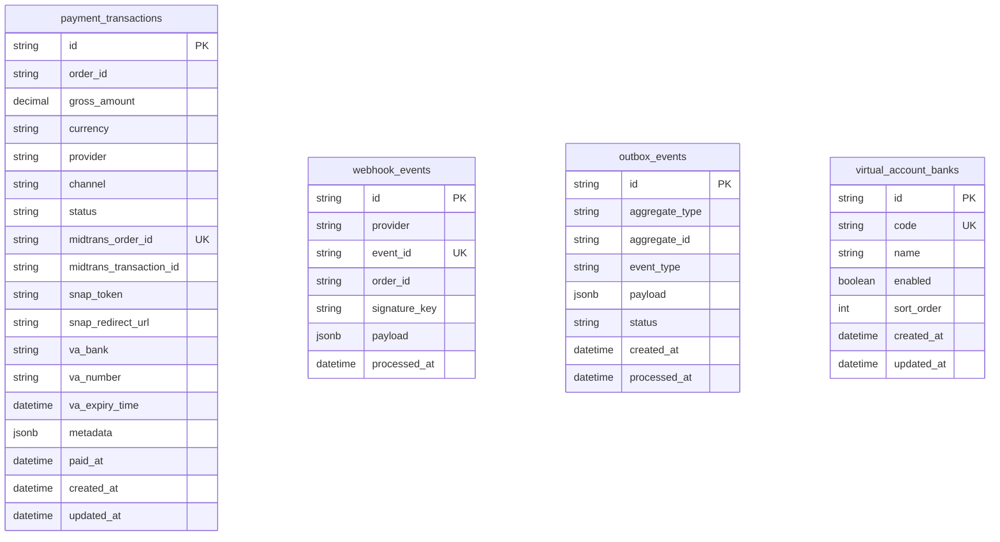

# Billing & Payment Service

Centralized payment gateway integration API for Midtrans payments, payment webhooks, and transactional event delivery. The service is built with NestJS, TypeScript, Prisma, PostgreSQL, and Bun.

Detailed endpoint purposes, request flows, webhook processing, and payment lifecycles: [`docs/billing-flow.md`](docs/billing-flow.md).

## Capabilities

- Midtrans Snap checkout, direct QRIS, and Virtual Account payment initiation
- Multi-attempt payment transaction history per external order
- Public Midtrans webhook handling with SHA-512 signature validation
- Idempotent payment settlement processing
- Transactional outbox events with Kafka publication (`billing.payment.completed`, `billing.payment.failed`) and fallback relay
- Service-to-service authentication via `X-Api-Key` or Bearer header
- Configurable Virtual Account bank catalog
- Health checks, structured request logging, Prometheus metrics, and Swagger/OpenAPI documentation

## Runtime and package manager

Bun is required for installation, scripts, tests, and application runtime.

```bash
bun install
```

Do not use npm, Yarn, pnpm, `node`, or Node-based test runners. The committed lockfile is `bun.lock`.

## Quick start

1. Copy `.env.example` to `.env` and provide the required values:

```bash
cp .env.example .env
```

2. Start PostgreSQL and application dependencies:

```bash
docker compose up -d
```

3. Apply database migrations:

```bash
bunx prisma migrate dev
```

4. Start development server:

```bash
bun run start:dev
```

Default application port is `3000` (or `5000` via Docker Compose).

## Development commands

| Command | Purpose |
| --- | --- |
| `bun install` | Install dependencies from `bun.lock` |
| `bun run start` | Start the Nest application |
| `bun run start:dev` | Start in watch mode |
| `bun run start:debug` | Start in debug/watch mode |
| `bun run build` | Build to `dist/` |
| `bun run start:prod` | Run the built application with Bun |
| `bun run lint` | Run ESLint check/fix |
| `bun run test` | Run test suite |
| `bun run test:cov` | Run tests with coverage and enforcement gate |
| `bunx prisma generate` | Generate Prisma client |
| `bunx prisma migrate dev` | Create/apply development migrations |
| `bunx prisma migrate deploy` | Apply migrations in deployment environments |
| `bun run docs:openapi` | Generate `contracts/openapi.json` |

## API

The application sets the global `/api` prefix. Swagger UI is available at `/docs`.

### Public endpoints

| Method | Path | Purpose |
| --- | --- | --- |
| `GET` | `/api/health` | Check database health |
| `POST` | `/api/v1/webhooks/midtrans` | Receive Midtrans payment notifications (SHA-512 validated) |

### Service-to-service endpoints

Protected by `ApiKeyGuard` (`X-Api-Key: <key>`, `X-Signature: <hmac-sha256>`, and `X-Timestamp: <timestamp>`). Request signature is computed as `HMAC-SHA256(METHOD:PATH:TIMESTAMP:BODY_HASH, API_KEY)` with a 5-minute replay window. For full guide, code examples (Node.js, cURL, Python), and header format, see [API Signature Authentication Documentation](docs/api-signature-authentication.md). Payment initiation endpoints are automatically idempotent via Redis, deduplicating concurrent or duplicate requests by `orderId` and payload SHA-256 hash.

| Method | Path | Purpose |
| --- | --- | --- |
| `POST` | `/api/v1/payments/snap` | Initiate Midtrans Snap payment checkout |
| `POST` | `/api/v1/payments/qr` | Generate QRIS payment code |
| `POST` | `/api/v1/payments/virtual-account` | Create Midtrans bank Virtual Account |
| `GET` | `/api/v1/payments` | List latest payment transaction per external order; requires `startDate` and exclusive `endDate`, supports `status`, `page`, and `pageSize`, returns `data`, `page`, `pageSize`, and `total` |
| `GET` | `/api/v1/payments/:orderId` | Get latest payment status for an order |
| `GET` | `/api/v1/payments/:orderId/transactions` | Get payment attempt transactions for an order |
| `POST` | `/api/v1/payments/:orderId/sync` | Query Midtrans and reconcile one order's latest transaction |
| `POST` | `/api/v1/payments/sync` | Query Midtrans for explicit `orderIds` or all unsettled transactions if payload is omitted |
| `GET` | `/api/v1/payment-methods/virtual-account` | List enabled Virtual Account banks |
| `POST` | `/api/v1/signatures/generate` | Generate HMAC-SHA256 request signature and headers for service-to-service calls |

### Operational endpoints

| Method | Path | Purpose |
| --- | --- | --- |
| `GET` | `/metrics` | Prometheus metrics (raw exposition format) |
| `GET` | `/docs` | Swagger UI |

## Configuration

| Variable | Required | Purpose |
| --- | --- | --- |
| `DATABASE_URL` | Yes | PostgreSQL connection string |
| `NODE_ENV` | No | `development`, `test`, or `production` |
| `PORT` | No | HTTP port; defaults to `3504` |
| `API_KEY` | No | Service-to-service authentication secret |
| `MIDTRANS_SERVER_KEY` | Yes for real payments | Midtrans server credential |
| `MIDTRANS_CLIENT_KEY` | Yes for real payments | Midtrans client credential |
| `MIDTRANS_IS_PRODUCTION` | No | Select Midtrans production or sandbox URLs |
| `KAFKA_ENABLED` | No | Defaults to `true` in production, `false` otherwise |
| `KAFKA_BROKERS` | No | Comma-separated Kafka brokers; defaults to `kafka:29092` |
| `KAFKA_CLIENT_ID` | No | Kafka client identifier; defaults to `billing-service` |
| `CORS_ORIGINS` | No | Comma-separated allowed origins |
| `REDIS_ENABLED` | No | Enable Redis idempotency; defaults to `true` (non-test) |
| `REDIS_URL` | No | Redis connection URL; defaults to `redis://localhost:6379` |
| `REDIS_IDEMPOTENCY_TTL_SECONDS` | No | Idempotency response cache TTL in seconds; defaults to `60` (1 minute) |
## Database design


