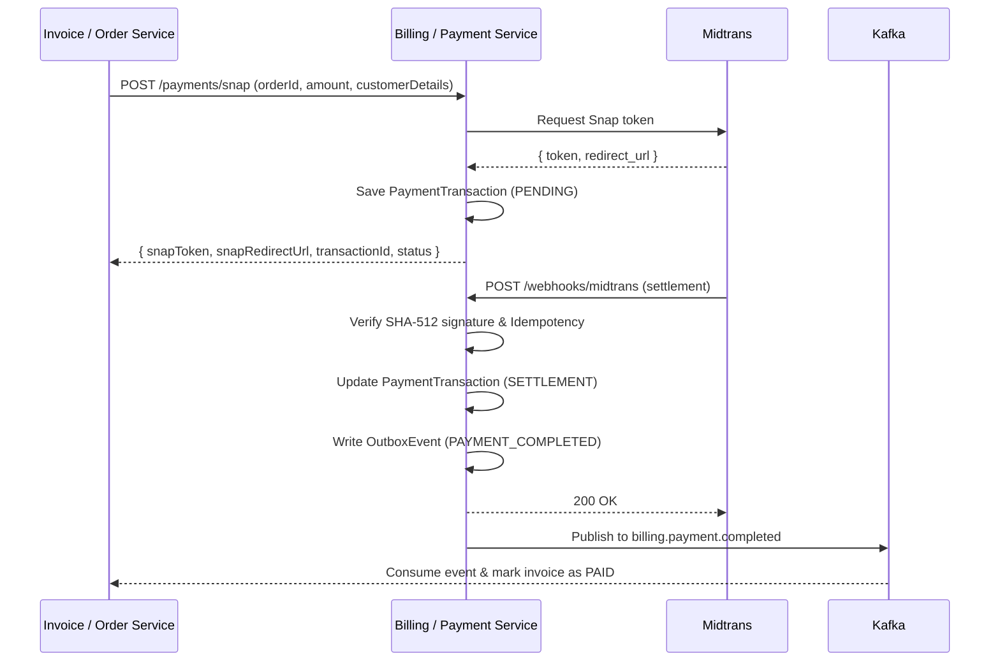

# Payment Integration Flow

Dokumen ini menjelaskan tujuan, kebutuhan, dan alur setiap endpoint payment integration service.

## Scope service

Service ini berfungsi sebagai payment gateway adapter khusus pembayaran Midtrans:

- Menginisiasi pembayaran Midtrans Snap checkout, QRIS, dan Virtual Account untuk order dari service lain.
- Menyimpan history payment attempts (`PaymentTransaction`) per `orderId`.
- Menerima dan memvalidasi webhook pembayaran Midtrans (SHA-512 signature check & idempotency).
- Menerbitkan event status pembayaran (`PAYMENT_COMPLETED`, `PAYMENT_FAILED`) ke Kafka via transactional outbox.
- Menyediakan katalog bank Virtual Account yang aktif.

Invoice, billing account, user management, dan subscription lifecycle dikelola sepenuhnya oleh service pemanggil (misal: Invoice/Order Service). Komunikasi antar service diproteksi oleh Request Signature HMAC-SHA256 (`X-Api-Key`, `X-Signature`, dan `X-Timestamp` header). Untuk panduan lengkap, lihat [Dokumentasi Autentikasi Signature](api-signature-authentication.md).

Satu `orderId` boleh memiliki beberapa payment attempt, tetapi hanya satu pembayaran sukses yang dianggap final. Jika attempt lama sudah `SETTLEMENT` atau `CAPTURE`, attempt baru untuk order tersebut ditolak. Jika data lama dan baru sudah terlanjur ada, status order tetap dianggap sukses berdasarkan attempt sukses, bukan attempt terbaru yang masih `PENDING`.

## Alur utama



---

## 1. `POST /api/v1/payments/snap`

### Tujuan
Menginisiasi sesi checkout Midtrans Snap untuk sebuah order. Dilindungi idempotency otomatis berbasis Redis (keyed by `orderId` + payload hash), sehingga request identik yang terulang tidak memanggil Midtrans dua kali.

### Header
```http
X-Api-Key: <internal-api-key>
```

### Request
```json
{
  "orderId": "INV-20261024-0001",
  "amount": 150000,
  "currency": "IDR",
  "channel": "SNAP_ALL",
  "customerName": "Alice",
  "customerEmail": "alice@example.com",
  "customerPhone": "081234567890",
  "description": "Subscription Renewal",
  "metadata": { "organizationId": "org-123" }
}
```

### Response
```json
{
  "orderId": "INV-20261024-0001",
  "transactionId": "3b290a88-f542-4217-8e10-c1bb7828c4bb",
  "midtransOrderId": "INV-20261024-0001-TX123456",
  "amount": 150000,
  "currency": "IDR",
  "snapToken": "snap-token-xyz",
  "snapRedirectUrl": "https://app.sandbox.midtrans.com/snap/v2/vtweb/token",
  "status": "PENDING"
}
```

---

## 2. `POST /api/v1/payments/qr`

### Tujuan
Membuat pembayaran QRIS langsung untuk ditampilkan pada aplikasi kasir/POS.

### Request
```json
{
  "orderId": "INV-20261024-0001",
  "amount": 150000,
  "customerName": "Alice",
  "description": "Subscription Renewal"
}
```

### Response
```json
{
  "orderId": "INV-20261024-0001",
  "transactionId": "3b290a88-f542-4217-8e10-c1bb7828c4bb",
  "midtransOrderId": "INV-20261024-0001-QR123456",
  "amount": 150000,
  "currency": "IDR",
  "qrString": "000201010212...",
  "qrImageUrl": "https://api.sandbox.midtrans.com/v2/qris/INV-20261024-0001-QR123456/qr-code",
  "expiresAt": "2026-10-24T12:15:00.000Z",
  "status": "PENDING"
}
```

---

## 3. `POST /api/v1/payments/virtual-account`

### Tujuan
Membuat nomor rekening Virtual Account Midtrans langsung tanpa popup Snap.

### Request
```json
{
  "orderId": "INV-20261024-0001",
  "amount": 150000,
  "bank": "bca"
}
```

Bank yang didukung divalidasi dari tabel `virtual_account_banks` (`bca`, `bni`, `bri`, `cimb`, `permata`).

### Response
```json
{
  "orderId": "INV-20261024-0001",
  "transactionId": "3b290a88-f542-4217-8e10-c1bb7828c4bb",
  "midtransOrderId": "INV-20261024-0001-VA123456",
  "bank": "bca",
  "vaNumber": "1234567890123456",
  "amount": 150000,
  "currency": "IDR",
  "expiryTime": "2026-10-25 12:00:00",
  "status": "PENDING"
}
```

---

## 4. `GET /api/v1/payments`

### Tujuan
Mengambil daftar order pembayaran dengan satu transaksi terbaru per `orderId`. `startDate` dan `endDate` wajib diisi. `startDate` bersifat inclusive, sedangkan `endDate` exclusive. Query juga mendukung `status`, `page` (default 1), dan `pageSize` (default 50, maksimum 100). Range tanggal membatasi order yang memiliki transaksi pada periode tersebut dan membantu mencegah query tanpa batas.

Contoh:

```text
GET /api/v1/payments?startDate=2026-10-01T00:00:00.000Z&endDate=2026-11-01T00:00:00.000Z&status=PENDING&page=1&pageSize=50
```

Response menggunakan format `{ data, page, pageSize, total }`. `total` adalah jumlah order unik setelah transaksi terbaru per order dipilih dan filter status diterapkan.

---

## 5. `GET /api/v1/payments/:orderId`

### Tujuan
Mengambil status pembayaran terkini untuk sebuah order (mengembalikan attempt transaksi paling baru).

---

## 6. `GET /api/v1/payments/:orderId/transactions`

### Tujuan
Mengambil semua riwayat transaksi / payment attempts untuk order tersebut (misal jika user mencoba ulang setelah transaksi sebelumnya expired).

---

## 7. `POST /api/v1/payments/:orderId/sync`

### Tujuan
Meminta status terbaru satu payment attempt ke Midtrans ketika webhook terlewat karena service tidak tersedia. Service mencari attempt terbaru untuk `orderId`, memanggil Midtrans Core API `GET /v2/{midtransOrderId}/status`, lalu memperbarui status lokal jika berubah.

Jika status berubah menjadi `settlement` atau `capture` dengan fraud status `accept`, service menulis event `PAYMENT_COMPLETED`. Untuk `deny`, `cancel`, atau `expire`, service menulis `PAYMENT_FAILED`. Event menggunakan transactional outbox.

Response menandai `statusChanged`, `previousStatus`, `status`, dan `synced`. Jika Midtrans tidak menemukan transaksi, `synced` bernilai `false` dan transaksi lokal tidak diubah.

---

## 8. `POST /api/v1/payments/sync`

### Tujuan
Rekonsiliasi beberapa transaksi sekaligus setelah downtime.

Dengan body berikut, hanya order yang disebutkan yang diproses:

```json
{
  "orderIds": ["ORD-20261024-0001", "ORD-20261024-0002"]
}
```

Jika payload tidak dikirimkan atau `orderIds` kosong, service secara otomatis mengambil seluruh transaksi yang belum settle (`status` bukan `SETTLEMENT` atau `CAPTURE`) untuk disinkronkan ke Midtrans. Response berisi `total`, jumlah `updated`, dan hasil per transaksi. Endpoint ini sebaiknya dipanggil oleh job internal dengan rate limit agar tidak membebani Core API Midtrans.

---

## 9. `GET /api/v1/payment-methods/virtual-account`


### Tujuan
Mengambil daftar bank Virtual Account yang aktif untuk ditampilkan di pilihan frontend caller:
```json
[
  { "code": "bca", "name": "BCA Virtual Account" },
  { "code": "bni", "name": "BNI Virtual Account" }
]
```

---

## 10. `POST /api/v1/webhooks/midtrans`

### Tujuan
Endpoint publik penerima notifikasi callback dari Midtrans.

### Keamanan & Idempotency
1. Validasi SHA-512 signature dari `order_id + status_code + gross_amount + MIDTRANS_SERVER_KEY`.
2. Pengecekan idempotency via tabel `webhook_events`. Event duplicate dilewati (`ALREADY_PROCESSED`).
3. Update status `payment_transactions` (`SETTLEMENT`, `DENY`, `CANCEL`, `EXPIRE`).
4. Tulis outbox event dalam satu database transaction:
   - `PAYMENT_COMPLETED` ke topic `billing.payment.completed`
   - `PAYMENT_FAILED` ke topic `billing.payment.failed`

---

## 11. `GET /api/health`

Endpoint publik untuk liveness/readiness probe database.

---

## 12. `GET /metrics`

Endpoint raw Prometheus exposition format di luar prefix `/api`.
